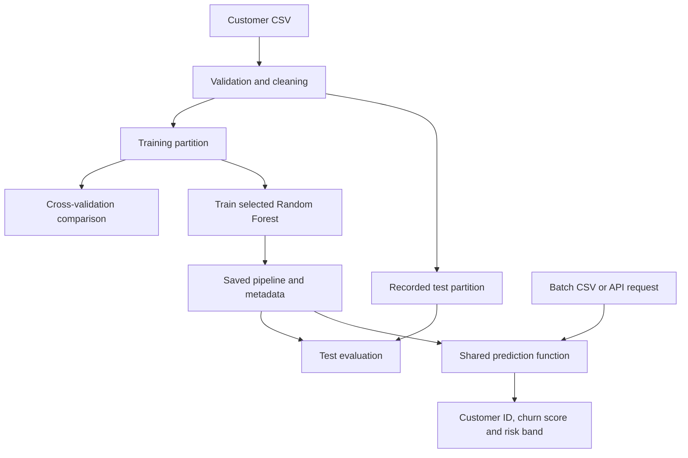

# Kenya Bank Customer Churn Prediction

[](https://github.com/VincentMunene/kenya-bank-customer-churn/actions/workflows/ci.yml)

An academic machine-learning project for predicting customer churn in a
Kenyan financial institution context.

The project includes scripted data preparation, model comparison,
training, evaluation, batch prediction and a Dockerized FastAPI service.
No notebook is required to run the submitted system.

## Problem and dataset

The objective is to identify customers who may churn and support
retention review.

| Item | Description |
|---|---|
| Dataset | `data/raw/CBCustomer_Churn.csv` |
| Customers | 7,043 |
| Churners | 494 |
| Churn rate | 7.01% |
| Target | `Churn Value`: 1 = churn, 0 = no churn |
| Monetary values | Kenyan shillings (KES) |

The dataset is treated as synthetic data derived from real world attributes given the sensitivity. It is
not presented as actual customer records from a bank.

## Architecture



## Project structure

| Path | Purpose |
|---|---|
| `src/prepare_data.py` | Validate and clean customer data |
| `src/features.py` | Shared preprocessing and feature functions |
| `src/compare_models.py` | Compare classifiers using training cross-validation |
| `src/train.py` | Train and serialize the selected Random Forest |
| `src/evaluate.py` | Evaluate the recorded test partition |
| `src/predict.py` | Batch prediction and shared scoring |
| `api/main.py` | FastAPI application |
| `api/schemas.py` | Request and response validation |
| `data/raw/` | Source dataset |
| `data/processed/` | Generated cleaned dataset |
| `artifacts/` | Saved model, metadata and evaluation outputs |
| `examples/` | Example CSV and JSON inputs |
| `tests/test_api.py` | API integration tests |
| `reports/final_report.md` | Project report |
| `requirements-lock.txt` | Recorded development dependencies |
| `requirements-runtime.txt` | Serving dependencies |
| `Dockerfile` | Container image definition |
| `docker-compose.yml` | Local container configuration |
| `AI_USE.md` | AI assistance disclosure |

## Model inputs and preprocessing

The model uses 16 raw inputs:

- Tenure in months.
- Monthly transaction value and total relationship value.
- Nine service flags: debit card, mobile banking, internet banking,
  SMS alerts, standing orders, loan product, savings product,
  insurance product and e-statements.
- Primary account, customer segment, preferred transaction channel
  and county.

Customer identifiers are retained for traceability but excluded from
model predictors.

Churn Label and Churn Reason are excluded because they describe the
outcome and could cause target leakage. Churn Score and Customer Lifetime
Value are excluded because their calculation timing and data origins
are unverified.

Age band and gender were assessed through training-only cross-validation.
Including both increased mean F1 slightly, from 0.2519 to 0.2589, while
recall decreased from 34.43% to 33.16%. They were excluded from the final
model to retain a simpler input contract given the small improvement.
Their exclusion does not guarantee fairness.

The selected model uses the original inputs with:

- Median imputation and standard scaling for numeric columns.
- Most-frequent imputation for service flags.
- Constant-value imputation and one-hot encoding for categorical columns.


All preprocessing is fitted inside each cross-validation
training fold. The final fitted pipeline is reused for prediction.

## Local setup

Use Python 3.10, matching the training environment.

Run the following in Windows PowerShell:

```powershell
git clone https://github.com/VincentMunene/kenya-bank-customer-churn.git
cd kenya-bank-customer-churn

python -m venv .venv
.\.venv\Scripts\Activate.ps1

python -m pip install --upgrade pip
python -m pip install -r requirements-lock.txt
python -m pip check
```

`requirements-lock.txt` records the Windows development environment.
`requirements-runtime.txt` pins the listed serving packages for Docker;
it is not a complete transitive dependency lock.

Only load trusted joblib model files.

## Reproduce the workflow

Run all commands from the repository root:

```powershell
python -m src.prepare_data
python -m src.compare_models
python -m src.train
python -m src.evaluate
```

The preparation script writes the cleaned dataset. The comparison and
training scripts read the raw CSV through the same shared cleaning
function.

A stratified split with random seed 42 assigns:

- 5,634 customers to training.
- 1,409 customers to testing.

Model comparison uses five-fold stratified cross-validation on the
training partition. The test partition is excluded from model selection.

The training script contains the selected Random Forest parameters
explicitly. It does not require an exported boosting configuration.

Training saves the model, metadata, split assignments and training
out-of-fold scores. Evaluation checks the dataset checksum and uses the
recorded test partition.

## Model comparison

The comparison includes a dummy baseline and two algorithms, each
with and without class weighting.

Mean training cross-validation results:

| Model | Accuracy | Precision | Recall | F1 | ROC-AUC |
|---|---:|---:|---:|---:|---:|
| Dummy baseline | 0.9299 | 0.0000 | 0.0000 | 0.0000 | 0.5000 |
| Logistic Regression | 0.9299 | 0.0000 | 0.0000 | 0.0000 | 0.6856 |
| Logistic Regression, balanced | 0.6555 | 0.1200 | 0.6177 | 0.2009 | 0.6774 |
| Random Forest | 0.9299 | 0.0000 | 0.0000 | 0.0000 | 0.7339 |
| Random Forest, balanced | 0.8568 | 0.1987 | 0.3443 | 0.2519 | 0.7195 |

Balanced Random Forest was selected because it achieved the highest mean
validation F1. F1 balances precision and recall for the churn class.

The unweighted models achieved high accuracy but identified no churners
at their default classification threshold. This demonstrates why
accuracy alone is insufficient for this imbalanced dataset.

Cross-validation results, including fold standard deviations, are saved
in `artifacts/simple_model_cv_results.csv`.

## Selected model

The selected Random Forest uses:

| Parameter | Value |
|---|---|
| Number of trees | 200 |
| Maximum depth | 8 |
| Minimum samples per leaf | 5 |
| Class weighting | Balanced |
| Random seed | 42 |
| Probability calibration | None |

Logistic Regression provides a simple linear comparison. Random Forest
can capture nonlinear relationships and interactions. Class weighting
gives the minority churn class more influence during training.

## Test evaluation

Results on the recorded test partition:

| Metric | Result |
|---|---:|
| Accuracy | 86.59% |
| Precision | 25.54% |
| Recall | 47.47% |
| F1 score | 0.3322 |
| ROC-AUC | 0.7609 |

Confusion matrix:

| Actual class | Predicted no churn | Predicted churn |
|---|---:|---:|
| No churn | 1,173 | 137 |
| Churn | 52 | 47 |

The model correctly identified 47 of 99 churners, missed 52 churners
and incorrectly flagged 137 non-churners.

Predicting no churn for every test customer would achieve approximately
92.97% accuracy but zero churn recall.

Metric interpretation:

- **Accuracy:** proportion of all customers classified correctly.
- **Precision:** proportion of predicted churners who actually churned.
- **Recall:** proportion of actual churners identified.
- **F1:** harmonic mean of churn precision and recall.
- **ROC-AUC:** ability to rank churners above non-churners across thresholds.

Accuracy, precision, recall and F1 use `model.predict()`. The model chooses
the highest-probability class, assigning ties to class 0. ROC-AUC uses
probability scores.

These results use the default classification rule, not a top-10%
contact-capacity policy.

The test partition was examined during earlier project development.
These results are therefore not a new independent validation.

Evaluation writes:

- `artifacts/script_test_metrics.json`
- `artifacts/script_test_predictions.csv`
- `artifacts/test_confusion_matrix.csv`

These files describe the current model. Older experimental artifacts,
if present, should not be interpreted as its results.

## Batch prediction

```powershell
python -m src.predict --input examples/customers.csv --output artifacts/example_predictions.csv
```

Output columns:

| Column | Meaning |
|---|---|
| `customer_id` | Customer identifier |
| `p_churn` | Uncalibrated model probability score |
| `risk_band` | Low, Medium or High based on training-derived cutoffs |

The model uses class weighting. Its scores should not be interpreted
as verified absolute probabilities of churn.

Risk bands use the 70th and 90th percentiles of training out-of-fold
scores. They are descriptive categories, separate from the classification
rule used for evaluation, and do not enforce a fixed contact capacity.

## Run the API locally

```powershell
python -m uvicorn api.main:app --host 127.0.0.1 --port 8000
```

Endpoints:

- Health: http://127.0.0.1:8000/health
- Interactive documentation: http://127.0.0.1:8000/docs
- Predictions: `POST /predict`

The API loads the saved model at startup and does not retrain per request.

Use `examples/request.json` as the request template:

```powershell
$response = Invoke-RestMethod `
    -Uri "http://127.0.0.1:8000/predict" `
    -Method Post `
    -ContentType "application/json" `
    -Body (Get-Content .\examples\request.json -Raw)

$response | ConvertTo-Json -Depth 5
```

Verified example response:

```json
{
  "predictions": [
    {
      "customer_id": "CBK-2019-0000001",
      "p_churn": 0.4191376229720125,
      "risk_band": "Medium"
    }
  ]
}
```

## API input validation

- Supply 1–1,000 customers per request.
- Customer IDs must be present and unique within the request.
- Service flags must use `"Yes"` or `"No"`.
- Tenure must be a nonnegative integer.
- Monetary values must be finite and nonnegative.
- Required fields must be supplied.
- Unexpected fields, including outcome fields, are rejected.

Invalid requests return HTTP 422.

## Run with Docker

Start Docker Desktop and ensure the Linux engine is running.

Stop any local API server using port 8000, then run:

```powershell
docker compose up --build -d
docker compose ps
```

Check health:

```powershell
Invoke-RestMethod -Uri "http://127.0.0.1:8000/health"
```

The health response should identify Random Forest with calibration
set to `none`. Submit the example prediction request using the same
PowerShell command shown above.

Inspect logs:

```powershell
docker compose logs --tail 50 churn-api
```

Stop the container:

```powershell
docker compose down
```

The image includes the application code, saved model and metadata.
The training dataset is not required for serving predictions.

After retraining or changing application code, rebuild the image:

```powershell
docker compose up --build -d
```

## Tests and verification

Run the API integration tests:

```powershell
python -m pytest tests/test_api.py -q
```

Seven tests cover:

- Health endpoint.
- Agreement between API and batch predictions.
- Negative tenure rejection.
- Missing required field rejection.
- Outcome-field rejection.
- Empty batch rejection.
- Duplicate customer ID rejection.

All seven tests passed with the Random Forest model. A TestClient
dependency deprecation warning was observed but did not fail the tests.

Training, model reload, batch prediction, Docker image build and
prediction through the container were also verified in the development
environment.

A fresh-clone reproduction check remains to be completed. Dependency
versions are recorded, but bit-for-bit reproducibility across platforms
is not claimed.

## Continuous integration

GitHub Actions runs automatically on pushes and pull requests to main.
The workflow installs dependencies, runs API integration tests, builds
the Docker image and checks container health and prediction consistency.

These checks verify the committed model and serving application in a
fresh Linux runner. They do not retrain the model or deploy a public API.

Workflow: `.github/workflows/ci.yml`.

## Batch drift monitoring

The monitoring script compares incoming customer inputs with the recorded
training reference. It reports numeric and categorical distribution
changes, missing-value changes, unseen categories and prediction-score
changes.

Run monitoring on a new batch:

```powershell
python -m src.monitor --input examples/customers.csv --output-dir reports/monitoring/current
```

Distribution alerts require at least 200 customers. Smaller batches
receive an insufficient-batch-size status; data-quality findings are
still reported.

Reproduce the simulated demonstration:

```powershell
python -m src.create_monitoring_demo
python -m src.monitor --input examples/monitoring/baseline.csv --output-dir reports/monitoring/baseline
python -m src.monitor --input examples/monitoring/shifted.csv --output-dir reports/monitoring/shifted
```

The demonstration reuses 500 training customers and does not provide
independent validation. The shifted version deliberately reduces monthly
transaction values and changes mobile banking, internet banking and
preferred transaction channel.

| Batch | Status | Input alerts | Score KS distance |
|---|---|---:|---:|
| Baseline | no_alert_detected | 0 | 0.0291 |
| Shifted | review_required | 4 | 0.3529 |

Thresholds are illustrative and require validation before operational
use. Alerts prompt investigation; they do not trigger automatic
retraining. Input or prediction drift does not establish concept drift
or performance decline. Actual churn outcomes are needed to measure
ongoing predictive performance.


## Limitations

- Synthetic data does not establish performance on real
  Kenyan bank customers.
- Predicting churn does not establish whether a retention intervention
  will prevent it.
- The API is a local academic demonstration and requires additional
  security, monitoring and validation before production use.

## Report and AI disclosure

- [Final report](reports/final_report.md)
- [AI assistance disclosure](AI_USE.md)