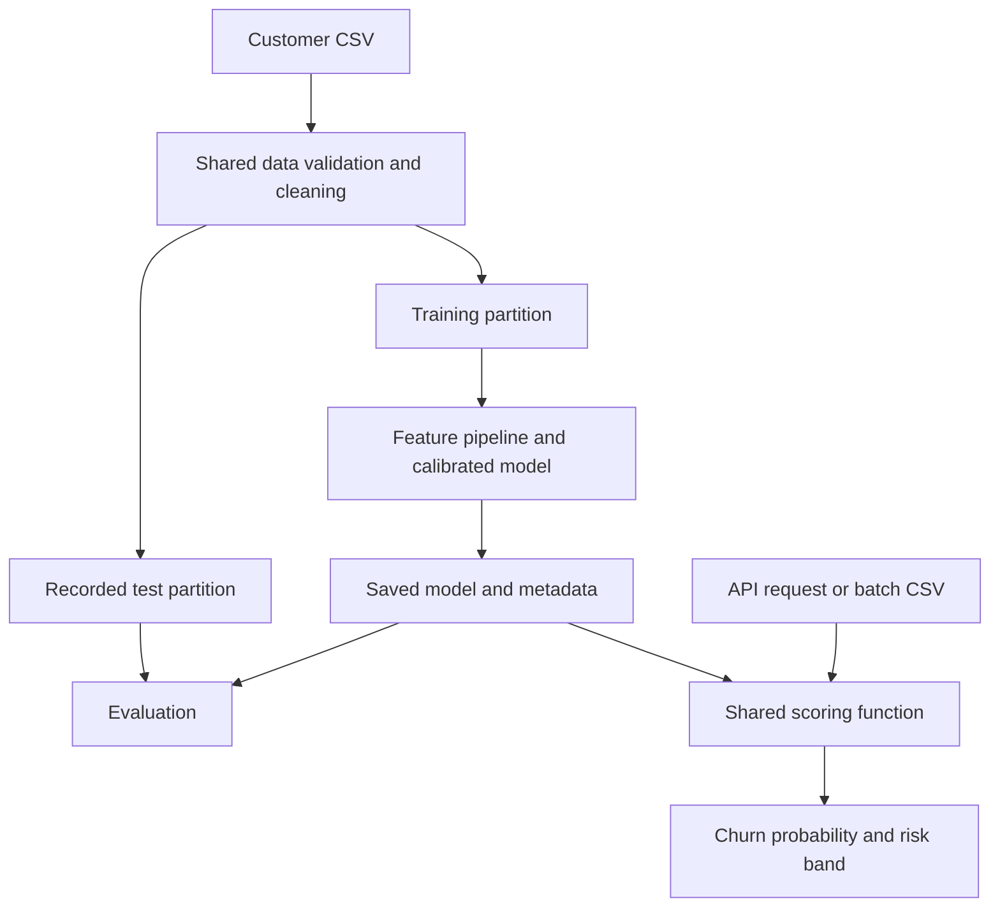

# Kenya Bank Customer Churn Prediction

An academic machine-learning project demonstrating customer churn
analysis, reproducible training, batch prediction and a containerized
FastAPI service.

The notebook is for analysis. Training and serving run independently
through Python modules.

## Problem and data

The project ranks customers by estimated churn risk to support retention
review under limited contact capacity.

- Dataset: `data/raw/CBCustomer_Churn.csv`
- Customers: 7,043
- Churned customers: 494 (7.01%)
- Target: `Churn Value`
- Monetary values: KES

The dataset is used as a synthetic/illustrative academic dataset.
It is not evidence of actual customer behavior at a named bank.

Identifiers and outcome-related fields are excluded from model inputs.
These include Churn Label, Churn Reason, Churn Score and Customer
Lifetime Value. Demographic fields are excluded from the final model
and retained in the notebook for subgroup analysis.

## Architecture



## Project structure

| Path | Purpose |
|---|---|
| `notebooks/` | Exploratory analysis and model experiments |
| `src/prepare_data.py` | Validate and clean customer data |
| `src/features.py` | Feature engineering and preprocessing |
| `src/train.py` | Train and serialize the selected model |
| `src/evaluate.py` | Evaluate using the recorded test partition |
| `src/predict.py` | Batch scoring and shared inference functions |
| `api/main.py` | FastAPI application |
| `api/schemas.py` | Request and response validation |
| `artifacts/` | Model, configuration, metrics and split records |
| `examples/` | Example CSV and JSON inputs |
| `tests/test_api.py` | API integration tests |
| `Dockerfile` | Serving image |
| `docker-compose.yml` | Local container configuration |

## Local setup

Use Python 3.10, matching the model-training environment.

```powershell
git clone https://github.com/VincentMunene/kenya-bank-customer-churn.git
cd kenya-bank-customer-churn

python -m venv .venv
.\.venv\Scripts\Activate.ps1

python -m pip install --upgrade pip
python -m pip install -r requirements-lock.txt
python -m pip check
```

`requirements-lock.txt` records the Windows development environment.
`requirements-runtime.txt` pins the listed serving packages for Docker;
it is not a complete transitive dependency lock.

Only load trusted joblib artifacts.

## Reproduce data processing, training and evaluation

Run commands from the repository root:

```powershell
python -m src.prepare_data
python -m src.train
python -m src.evaluate
```

Training reads the committed configuration:

```text
artifacts/selected_hgb_params.json
```

This configuration came from notebook hyperparameter search.
The training script reproduces the selected approach without rerunning
the search or requiring an active notebook.

Training uses 5,634 customers. The recorded test partition contains
1,409 customers, including 99 churners. Preprocessing is fitted within
the training and calibration folds.

The dataset checksum and library versions are recorded in:

```text
artifacts/model_metadata.json
```

Evaluation verifies the dataset checksum and uses:

```text
artifacts/split_manifest.csv
```

## Model and results

Selected approach: Histogram Gradient Boosting with sigmoid calibration.

Results from the standalone evaluation script:

| Metric | Result |
|---|---:|
| ROC-AUC | 0.7639 |
| Average precision | 0.2036 |
| Brier score | 0.0604 |
| Maximum contacts under strict 10% capacity | 140 |
| Churners reached | 36 of 99 |
| Recall at capacity | 36.36% |
| Precision at capacity | 25.71% |

The notebook's rounded-up top-decile metric uses 141 customers;
the script's strict capacity rule uses 140.

This evaluation reproduces results on a previously examined holdout.
It is not a new independent validation.

## Batch prediction

```powershell
python -m src.predict --input examples/customers.csv --output artifacts/example_predictions.csv
```

Output columns:

- `customer_id`
- `p_churn`
- `risk_band`

Risk bands use training-derived score cutoffs. They do not enforce a
fixed contact capacity.

## Run the API locally

```powershell
python -m uvicorn api.main:app --host 127.0.0.1 --port 8000
```

- Health: http://127.0.0.1:8000/health
- Interactive documentation: http://127.0.0.1:8000/docs
- Predictions: `POST /predict`

The API loads the model at startup and does not retrain per request.

## Run with Docker

Docker Desktop must be running with Linux containers.

Stop any local API server using port 8000, then run:

```powershell
docker compose up --build -d
docker compose ps
```

Check health and submit the example request:

```powershell
Invoke-RestMethod -Uri "http://127.0.0.1:8000/health"

$response = Invoke-RestMethod `
    -Uri "http://127.0.0.1:8000/predict" `
    -Method Post `
    -ContentType "application/json" `
    -Body (Get-Content examples/request.json -Raw)

$response | ConvertTo-Json -Depth 5
```

Inspect logs or stop the container:

```powershell
docker compose logs --tail 50 churn-api
docker compose down
```

The serving image includes the saved model and application code.
It does not require the dataset or notebook.

## API input contract

Use `examples/request.json` as the request template.

- Supply 1–1,000 customers per request.
- Customer IDs must be present and unique within the request.
- Service flags use `"Yes"` or `"No"`.
- Tenure must be a nonnegative integer.
- Monetary values must be finite and nonnegative.
- Missing required fields and unexpected fields are rejected.
- Outcome fields must not be supplied.

Invalid requests return HTTP 422.

## Tests

```powershell
python -m pytest tests/test_api.py -q
```

Seven integration tests cover health, prediction consistency, negative
tenure, missing fields, outcome-field rejection, empty batches and
duplicate customer IDs.

The tests passed in the development environment. A TestClient dependency
deprecation warning was observed; it did not prevent execution.

## Limitations

- Synthetic/illustrative data does not establish production performance.
- Observation dates and the churn prediction horizon are unverified.
- Random splitting does not demonstrate future-period generalization.
- Small positive-class and subgroup samples create uncertainty.
- Calibration does not guarantee accurate probabilities in a new population.
- Churn risk is not the same as responsiveness to a retention intervention.
- Notebook financial scenarios use assumed costs and intervention effects;
  they are not realized savings.
- The API is a local academic demonstration, not a production bank service.